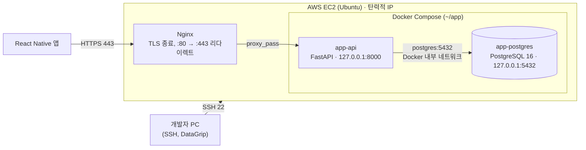

# 배포 파이프라인 가이드

> **Draft doc.** 진행하면서 실제 값(인스턴스 타입, 도메인 등)이 확정되면 갱신하세요.

KeepLog의 API 서버와 DB를 AWS EC2 한 대에 배포하는 구성과 순서를 정리합니다.

## Contents

1. [배포 대상](#01-배포-대상)
2. [전체 아키텍처](#02-전체-아키텍처)
3. [핵심 개념](#03-핵심-개념)
4. [EC2 서버 구성](#04-ec2-서버-구성)
5. [Docker Compose 구성](#05-docker-compose-구성)
6. [Nginx 리버스 프록시와 HTTPS](#06-nginx-리버스-프록시와-https)
7. [배포 단계와 진행 상황](#07-배포-단계와-진행-상황)
8. [체크리스트](#08-체크리스트)

---

## 01 / 배포 대상

| 구성 요소 | 스택 | 배포 방식 |
|---|---|---|
| `front/` | React Native (iOS + Android) | App Store / Play Store. 서버 배포 대상이 아니며, 앱은 HTTPS로 API만 호출합니다. |
| `server/` | FastAPI (Python 3.12) | Docker 이미지 → EC2의 컨테이너 |
| DB | PostgreSQL 16 | EC2의 컨테이너, 데이터는 Docker Volume에 영속화 |
| 리버스 프록시 | Nginx + Let's Encrypt(Certbot) | EC2 호스트에 직접 설치 |

## 02 / 전체 아키텍처



- 외부에서 들어오는 포트는 **22(SSH), 80(HTTP), 443(HTTPS)** 세 개뿐입니다.
- API(8000)와 DB(5432)는 `127.0.0.1`에만 바인딩되어 EC2 바깥에서는 보이지 않습니다. API는 Nginx를 통해서만, DB는 SSH 터널을 통해서만 접근합니다.
- 컨테이너끼리는 Docker Compose가 만드는 내부 네트워크에서 **서비스 이름**(`postgres`)으로 통신합니다.

## 03 / 핵심 개념

- **EC2**: AWS의 가상 서버. 탄력적 IP를 붙여서 재시작해도 주소가 바뀌지 않게 합니다. 탄력적 IP는 인스턴스에 연결되지 않은 상태로 두면 요금이 나옵니다.
- **보안 그룹**: EC2 앞단의 방화벽. 인바운드 규칙에 열어준 포트만 들어올 수 있습니다.
- **Docker 이미지 / 컨테이너**: 이미지는 실행 환경까지 포함한 패키지, 컨테이너는 그 이미지를 실행한 프로세스입니다. 로컬과 서버에서 같은 이미지를 쓰므로 "내 PC에서는 되는데"가 줄어듭니다.
- **Docker Compose**: 여러 컨테이너(API, DB)를 `docker-compose.yml` 하나로 정의하고 함께 띄우는 도구입니다.
- **Volume**: 컨테이너를 지워도 남는 저장 공간. DB 데이터는 반드시 Volume에 둡니다(`pg-data`).
- **리버스 프록시(Nginx)**: 외부 요청을 받아 내부 서비스(API 컨테이너)로 넘겨주는 앞단 서버. HTTPS 인증서 처리도 여기서 합니다.
- **SSH 터널**: SSH 연결 안으로 다른 포트(5432)의 트래픽을 통과시키는 방법. DB 포트를 외부에 열지 않고 DataGrip으로 접속할 수 있습니다.
- **마이그레이션(Alembic)**: DB 스키마 변경을 코드로 기록하고 순서대로 적용하는 도구. 운영 DB 스키마는 `alembic upgrade head`로만 바꿉니다.

## 04 / EC2 서버 구성

| 항목 | 값 |
|---|---|
| OS | Ubuntu (SSH 유저 `ubuntu`) |
| 주소 | 탄력적 IP |
| 보안 그룹 인바운드 | 22 (SSH), 80 (HTTP), 443 (HTTPS) |
| 런타임 | Docker Engine + Docker Compose 플러그인 (Docker 공식 apt 저장소) |
| 작업 디렉토리 | `~/app/` |

로컬 `~/.ssh/config` 예시 (`.pem` 키는 `~/.ssh/`에 두고 `chmod 400`):

```
Host app-server
    HostName <탄력적 IP>
    User ubuntu
    IdentityFile ~/.ssh/<키 파일>.pem
```

DataGrip 접속: General 탭 `localhost:5432` + DB 계정, SSH/SSL 탭에서 위 SSH 정보로 터널 사용.

> **SSH 보안**: 여러 장소에서 접속하기 위해 SSH 소스를 `0.0.0.0/0`으로 열어둔 상태입니다. 공개 전에 ① 비밀번호 로그인 비활성화 + fail2ban, 또는 ② SSM Session Manager로 전환하고 22번 포트 닫기 중 하나를 적용합니다.

## 05 / Docker Compose 구성

서버의 `~/app/` 구조:

```
~/app/
├── docker-compose.yml
├── .env            # POSTGRES_*, DATABASE_URL (chmod 600, git에 올리지 않음)
└── KeepLog/        # git clone한 저장소 (API 이미지 빌드 소스)
```

`docker-compose.yml` (DB는 구축 완료, `api` 서비스는 Phase 7에서 추가):

```yaml
services:
  postgres:
    image: postgres:16
    container_name: app-postgres
    restart: unless-stopped
    env_file:
      - .env
    ports:
      - "127.0.0.1:5432:5432"
    volumes:
      - pg-data:/var/lib/postgresql/data
    healthcheck:
      test: ["CMD-SHELL", "pg_isready -U $${POSTGRES_USER}"]
      interval: 5s
      retries: 10

  api:
    build: ./KeepLog/server
    container_name: app-api
    restart: unless-stopped
    env_file:
      - .env
    depends_on:
      postgres:
        condition: service_healthy
    ports:
      - "127.0.0.1:8000:8000"

volumes:
  pg-data:
```

`.env` 예시:

```env
POSTGRES_USER=app
POSTGRES_PASSWORD=<강력한 비밀번호>
POSTGRES_DB=app
DATABASE_URL=postgresql+psycopg2://app:<같은 비밀번호>@postgres:5432/app
```

`DATABASE_URL`의 호스트가 `localhost`가 아니라 **`postgres`(서비스 이름)**인 점에 주의하세요. API 컨테이너 안에서 `localhost`는 API 컨테이너 자신을 가리킵니다.

로컬 개발 환경(`server/docker-compose.yml`)은 Postgres만 띄우고 `localhost:5432`로 노출합니다. API는 로컬에서 `uvicorn`으로 직접 실행합니다.

## 06 / Nginx 리버스 프록시와 HTTPS

도메인의 A 레코드를 탄력적 IP로 연결한 뒤 설정합니다.

`/etc/nginx/sites-available/app`:

```nginx
server {
    listen 80;
    server_name api.example.com;

    location / {
        proxy_pass http://127.0.0.1:8000;
        proxy_set_header Host $host;
        proxy_set_header X-Real-IP $remote_addr;
        proxy_set_header X-Forwarded-For $proxy_add_x_forwarded_for;
        proxy_set_header X-Forwarded-Proto $scheme;
    }
}
```

```bash
sudo ln -s /etc/nginx/sites-available/app /etc/nginx/sites-enabled/
sudo nginx -t && sudo systemctl reload nginx
sudo certbot --nginx -d api.example.com   # 443 설정과 80 → 443 리다이렉트를 자동 추가
sudo certbot renew --dry-run              # 자동 갱신 확인
```

80번 포트는 Certbot의 인증서 발급·갱신 검증에 필요하므로 HTTPS 적용 후에도 열어둡니다.

## 07 / 배포 단계와 진행 상황

| 단계 | 내용 | 상태 |
|---|---|---|
| 1 | EC2 생성, 탄력적 IP, 보안 그룹(22/80/443) | 완료 |
| 2 | 로컬 SSH 설정, 접속 확인 | 완료 |
| 3 | 서버 초기 세팅, Docker 설치 | 완료 |
| 4 | PostgreSQL 컨테이너 (`~/app`, `127.0.0.1:5432`) | 완료 |
| 5 | DataGrip SSH 터널 접속 | 완료 |
| 6 | FastAPI 프로젝트, CRUD, 테스트, CI (로컬) | 완료 |
| 7 | `server/Dockerfile`, `api` 서비스 추가, 운영 DB에 `alembic upgrade head` | 다음 작업 |
| 8 | 도메인 연결, Nginx 리버스 프록시 | 예정 |
| 9 | Certbot HTTPS, 자동 갱신 | 예정 |
| 10 | React Native 앱에서 `https://<도메인>` 연동 테스트 | 예정 |
| 11 | GitHub Actions 배포 자동화, `pg_dump` 백업 → S3, 모니터링 | 이후 |

배포 1회 흐름 (7단계 이후 기준):


## 08 / 체크리스트

- [ ] 보안 그룹 인바운드가 22/80/443뿐인가
- [ ] DB와 API 포트가 `127.0.0.1`에만 바인딩되어 있는가
- [ ] 서버 `.env`가 `chmod 600`이고 git에 올라가지 않았는가
- [ ] `DATABASE_URL`의 호스트가 `postgres`(서비스 이름)인가
- [ ] DB 데이터가 `pg-data` Volume에 저장되는가
- [ ] 운영 DB 스키마 변경을 `alembic upgrade head`로만 했는가
- [ ] `/health`가 `{"status":"ok","db":"ok"}`를 반환하는가
- [ ] HTTPS 인증서 자동 갱신(`certbot renew --dry-run`)이 성공하는가
- [ ] SSH 보안 조치(fail2ban 또는 SSM)를 적용했는가
- [ ] DB 백업과 복구를 한 번 이상 실제로 해봤는가
