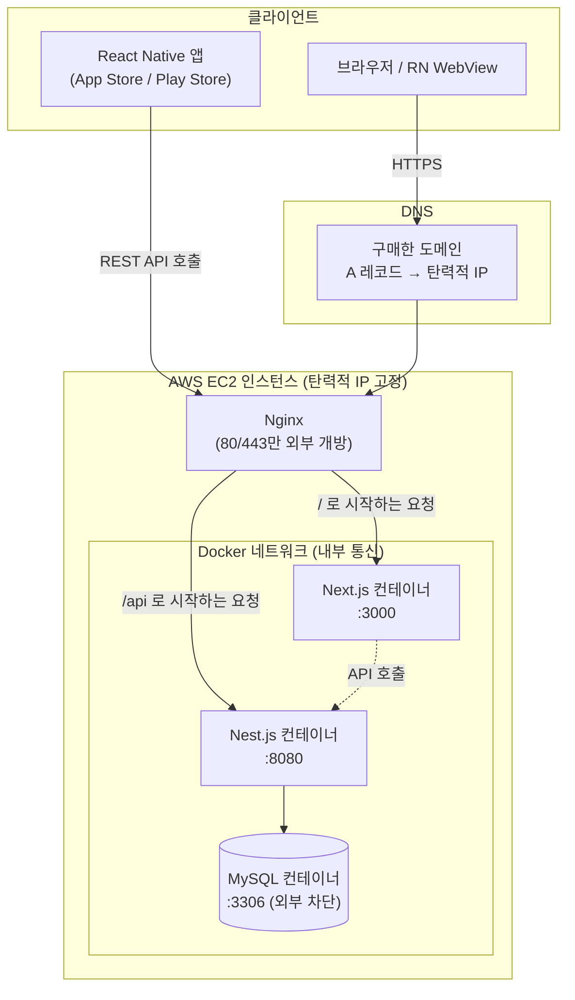
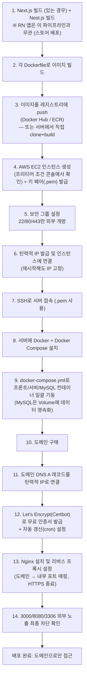

# 배포 파이프라인 가이드

> **Draft doc.** 초기 배포 설계 정리본입니다. 실제 진행하면서 세부값(인스턴스 타입, 프리티어 조건 등)은 AWS 콘솔에서 재확인 후 갱신하세요.

> **스택 변경 안내.** 이 문서는 `server/`가 Nest.js + MySQL이던 시점에 작성됐습니다. 현재 `server/`는 **FastAPI + PostgreSQL 16**이며, 서버 쪽 리소스 이름은 `keeplog` 대신 `app`을 씁니다(예: `~/app/db`, 컨테이너 `app-postgres`). 아키텍처 흐름(Docker 이미지 → 컨테이너 → Nginx 리버스 프록시, DB는 외부 차단)은 그대로 유효하지만, 아래의 Nest.js/MySQL 관련 설정 예시는 Phase 7(EC2 배포) 진행 시 갱신 예정입니다. 최신 서버 구성은 [`server/CLAUDE.md`](../server/CLAUDE.md)를 기준으로 보세요.

Docker/AWS/Nginx/MySQL 배경지식이 없는 프론트엔드 개발자를 대상으로, KeepLog를 실서비스에 배포하는 전체 과정을 정리합니다. 현재는 `front/`에 React Native만 세팅되어 있지만, 추후 Next.js 기반 웹뷰 프로젝트가 추가될 가능성을 고려해 웹 배포 경로까지 포함합니다.

## Contents

1. [배포 대상 정리](#01-배포-대상-정리)
2. [전체 아키텍처](#02-전체-아키텍처)
3. [핵심 개념 먼저 이해하기](#03-핵심-개념-먼저-이해하기)
4. [최종 파이프라인](#04-최종-파이프라인)
5. [Docker Compose 구성 예시](#05-docker-compose-구성-예시)
6. [Nginx 리버스 프록시 예시](#06-nginx-리버스-프록시-예시)
7. [체크리스트](#07-체크리스트)

---

## 01 / 배포 대상 정리

| 구성 요소 | 현재 상태 | 배포 방식 |
|---|---|---|
| `front/` (React Native) | 세팅 완료 | **이 파이프라인과 무관.** 서버/Docker/AWS로 배포하는 대상이 아니라, App Store / Play Store로 배포되는 별도 트랙. |
| `front/` 내 Next.js 웹뷰 (향후 추가 가능) | 미확정 | 이 문서의 Docker/AWS 파이프라인 대상 — Nest.js 서버와 동일한 흐름을 탄다. |
| `server/` (Nest.js) | 세팅 완료, MySQL 연동 확인됨 | 이 문서의 Docker/AWS 파이프라인 대상 |
| MySQL | `server/docker-compose.yml`로 로컬 개발용 컨테이너 구성됨 | 운영 환경에서도 컨테이너로 셀프호스팅 (아래 참고) |

Next.js 웹뷰가 추가될 경우 대비 사항 — RN 앱 안에서 `WebView`로 특정 화면만 로드하는 형태라면, 그 웹뷰가 가리키는 주소가 바로 이 파이프라인으로 배포된 Next.js 앱의 도메인입니다. 즉 Next.js는 "일반 사용자가 브라우저로 접근하는 웹사이트"인 동시에 "RN 앱 내부에서 열리는 화면"이라는 두 가지 소비 경로를 모두 가질 수 있습니다. 배포 방식 자체는 동일합니다 (Docker 이미지 → 컨테이너 → Nginx 리버스 프록시).

## 02 / 전체 아키텍처



- RN 앱은 화면은 자체 렌더링하고, 데이터만 Nest.js API(`/api/...`)를 호출합니다.
- 브라우저(또는 RN 내부 WebView)는 도메인으로 접속해 Next.js가 서빙하는 페이지를 받습니다.
- 외부에서 서버로 직접 열려 있는 포트는 **80/443(Nginx)** 뿐이고, 3000/8080/3306은 AWS 보안 그룹에서 차단되어 서버 내부 Docker 네트워크로만 통신합니다.

## 03 / 핵심 개념 먼저 이해하기

### Docker: 이미지 vs 컨테이너

- **이미지(Image)** = 앱 실행에 필요한 코드 + 런타임(Node.js 등)을 통째로 패키징한 템플릿. `Dockerfile`에 "어떤 베이스에서 시작해서 뭘 설치하고 뭘 실행할지" 적어서 빌드한다.
- **컨테이너(Container)** = 이미지를 실제로 실행한 인스턴스. `docker run <이미지>`를 하면 그 이미지를 기반으로 컨테이너가 생성되며 실행된다. **이미지가 먼저, 컨테이너가 나중**이며 반대 순서는 존재하지 않는다.
- **로컬에서 빌드한 이미지는 서버로 자동으로 옮겨지지 않는다.** 다음 둘 중 하나를 반드시 거쳐야 한다.
  - (A) 로컬에서 이미지 빌드 → Docker Hub / AWS ECR 같은 **이미지 레지스트리**에 push → 서버에서 pull
  - (B) 서버에 SSH 접속 → 서버에서 직접 `git clone` → 그 자리에서 `docker build`
- **Docker Compose**: 프론트/서버/DB처럼 컨테이너가 여러 개일 때, `docker-compose.yml` 파일 하나로 전부 정의하고 `docker compose up -d` 한 번으로 같이 띄우는 도구. 컨테이너를 하나씩 `docker run`으로 관리하지 않는다.
- **Volume**: 컨테이너는 삭제/재생성되면 내부 데이터가 사라진다. MySQL 데이터처럼 유지되어야 하는 데이터는 반드시 Docker Volume에 저장해야 컨테이너를 지워도 데이터가 남는다. (`server/docker-compose.yml`의 `mysql-data` 볼륨이 이미 이 역할.)

### AWS: 인스턴스, IP, 보안 그룹

- **EC2 인스턴스**: 서버로 쓸 가상 머신. 프리티어는 통상 `t2.micro`/`t3.micro`(1 vCPU, RAM 1GB) 기준이었으나 AWS가 프리티어 정책을 개편했으므로, 인스턴스 생성 시 콘솔에 뜨는 "프리 티어 사용 가능" 배지를 실제 기준으로 삼는다.
- **기본 퍼블릭 IP는 동적(변동)**: 인스턴스를 중지 후 재시작하면 IP가 바뀔 수 있다.
- **탄력적 IP(Elastic IP)**: 그 문제를 해결하는 AWS 기능. "변동되는 IP"가 아니라 **"고정 IP를 발급해주는 기능"**이다. 이걸 인스턴스에 연결하면 재시작해도 IP가 유지된다.
- **키 페어(.pem)**: 인스턴스를 **생성하는 시점**에 함께 발급/다운로드한다. 이후 `ssh -i key.pem ubuntu@<IP>` 형태로 접속할 때 매번 사용한다.
- **보안 그룹(Security Group)**: EC2에 붙는 방화벽. 운영 단계에서는 **22(SSH), 80, 443만 외부 개방**하고, 3000/8080/3306 같은 애플리케이션·DB 포트는 외부 접근을 차단해 Nginx만 외부와 맞닿게 한다.

### MySQL: 어디에 둘 것인가

- **RDS(관리형)**: AWS가 백업·패치·장애복구를 대신 해주는 별도 서비스. 관리 부담은 적지만 EC2와 별개 리소스라 프리티어 조건도 따로 확인 필요.
- **셀프호스팅(EC2 위 Docker 컨테이너)**: 프론트/서버 컨테이너와 같은 인스턴스 안에서 MySQL도 컨테이너 하나로 같이 띄우는 방식. 비용은 아끼지만 백업/복구를 직접 챙겨야 한다. `server/docker-compose.yml`에 이미 이 구조로 로컬 개발 환경이 구성되어 있으므로, 운영에서도 같은 구조를 그대로 확장하는 게 자연스럽다 (단, 운영에서는 `3306:3306` 포트를 호스트에 노출하지 말고 Docker 내부 네트워크로만 열어야 한다).

### Nginx: 리버스 프록시

Nginx는 외부에서 들어오는 모든 요청(80/443)을 받아서, 도메인이나 경로에 따라 내부 컨테이너 포트(3000, 8080)로 중계해주는 **리버스 프록시** 역할을 한다. 이 계층 덕분에 사용자는 `도메인.com`으로만 접속하고, `ip:3000`/`ip:8080` 같은 내부 포트는 몰라도 된다 (그리고 보안 그룹에서 차단되어 외부에서 직접 접근도 불가능하다). HTTPS 인증서도 Nginx에서 종료(SSL termination)한다.

### 환경변수/시크릿

DB 비밀번호, JWT 시크릿 등은 이미지에 하드코딩하지 않는다. `server/.env` 같은 파일이나 Docker Compose의 `environment` / `env_file`로 서버에서 주입하고, `.env`는 `.gitignore`로 커밋 대상에서 제외한다 (server는 이미 이렇게 구성됨).

## 04 / 최종 파이프라인



정정 반영 요약:

- (3번 코스 원문) "컨테이너를 띄우고 이미지를 올린다" → **이미지 빌드가 먼저, 컨테이너 실행이 나중**이며, 로컬 이미지를 서버로 옮기는 방법(레지스트리 push/pull 또는 서버에서 직접 build)을 명시.
- (원문 IP 서술) "탄력적 IP는 변동되는 IP" → **탄력적 IP는 고정 IP를 만들어주는 기능**이며, 변동되는 건 EC2의 기본 퍼블릭 IP.
- (원문 키 발급 위치) pem 키는 SSH 접속 직전이 아니라 **인스턴스 생성 시점**에 발급.
- (원문 마지막 단계) 도메인이 포트로 연결되도록 Nginx 설정 + **운영에서는 3000/8080 직접 접근을 보안 그룹으로 차단**해 도메인·Nginx 경로만 남기는 것까지 포함.
- 전체 누락분 3가지 반영: **환경변수/시크릿 관리**, **MySQL 데이터 Volume 영속화**, **도메인 DNS A 레코드 연결 단계**.

## 05 / Docker Compose 구성 예시

운영 서버에서 `docker-compose.yml` (front에 Next.js가 추가된 이후 기준, 아직 없다면 `web`/`api-web`(Nest.js) 두 서비스만 사용):

```yaml
services:
  web:
    build: ./front # Next.js 웹뷰 프로젝트 (향후 추가 시)
    restart: unless-stopped
    expose:
      - '3000'
    env_file: ./front/.env

  api:
    build: ./server
    restart: unless-stopped
    expose:
      - '8080'
    env_file: ./server/.env
    depends_on:
      - mysql

  mysql:
    image: mysql:8
    container_name: keeplog-mysql
    restart: unless-stopped
    expose:
      - '3306' # 호스트에 포트 매핑(ports)하지 않음 — 컨테이너 간 통신만 허용
    environment:
      MYSQL_DATABASE: keeplog
      MYSQL_USER: keeplog
      MYSQL_PASSWORD: ${DB_PASSWORD}
      MYSQL_ROOT_PASSWORD: ${DB_ROOT_PASSWORD}
    volumes:
      - mysql-data:/var/lib/mysql

  nginx:
    image: nginx:alpine
    restart: unless-stopped
    ports:
      - '80:80'
      - '443:443'
    volumes:
      - ./nginx.conf:/etc/nginx/conf.d/default.conf:ro
      - ./certbot/conf:/etc/letsencrypt:ro
    depends_on:
      - web
      - api

volumes:
  mysql-data:
```

`server/docker-compose.yml`(로컬 개발용, MySQL만 `ports: 3306:3306`으로 호스트에 노출)과의 차이: 운영에서는 `ports` 대신 `expose`를 써서 **호스트(외부)에 포트를 열지 않고 Docker 내부 네트워크로만** 다른 서비스가 접근하게 한다.

## 06 / Nginx 리버스 프록시 예시

```nginx
server {
    listen 80;
    server_name your-domain.com;
    return 301 https://$host$request_uri; # HTTP -> HTTPS 강제 리다이렉트
}

server {
    listen 443 ssl;
    server_name your-domain.com;

    ssl_certificate     /etc/letsencrypt/live/your-domain.com/fullchain.pem;
    ssl_certificate_key /etc/letsencrypt/live/your-domain.com/privkey.pem;

    location /api/ {
        proxy_pass http://api:8080/;
        proxy_set_header Host $host;
        proxy_set_header X-Real-IP $remote_addr;
    }

    location / {
        proxy_pass http://web:3000/;
        proxy_set_header Host $host;
        proxy_set_header X-Real-IP $remote_addr;
    }
}
```

`api`/`web`은 IP가 아니라 Docker Compose 서비스 이름으로 바로 참조 가능 (같은 Docker 네트워크에 있기 때문).

## 07 / 체크리스트

- [ ] AWS 프리티어 인스턴스 스펙을 콘솔에서 재확인했는가 (문서 작성 시점 지식이 아닌 실제 콘솔 기준)
- [ ] 보안 그룹에서 22/80/443만 열고 3000/8080/3306은 막았는가
- [ ] 탄력적 IP를 발급해 인스턴스에 고정했는가
- [ ] MySQL 컨테이너가 Volume으로 데이터 영속화되는가
- [ ] `.env`가 `.gitignore`에 포함되어 있고 커밋되지 않는가 (`server/`는 이미 적용됨)
- [ ] 도메인 DNS A 레코드가 탄력적 IP를 가리키는가
- [ ] Let's Encrypt 인증서 자동 갱신(cron)이 설정되어 있는가
- [ ] Nginx를 통하지 않고 `ip:3000` / `ip:8080`으로 직접 접근이 안 되는가 (보안 그룹 + `expose`로 이중 차단)
- [ ] Next.js 웹뷰가 추가되면 `front/`에 별도 `Dockerfile` + `nginx.conf`의 `location /` 라우팅을 함께 업데이트했는가
